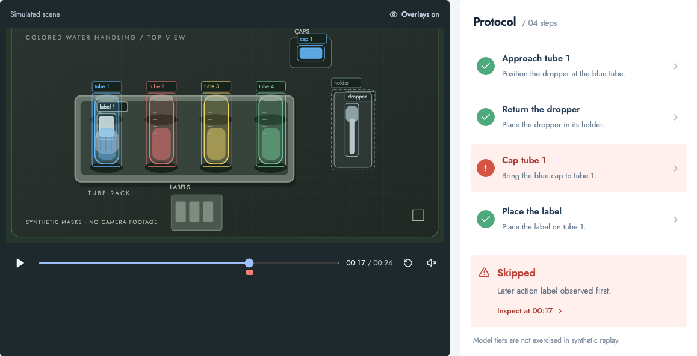
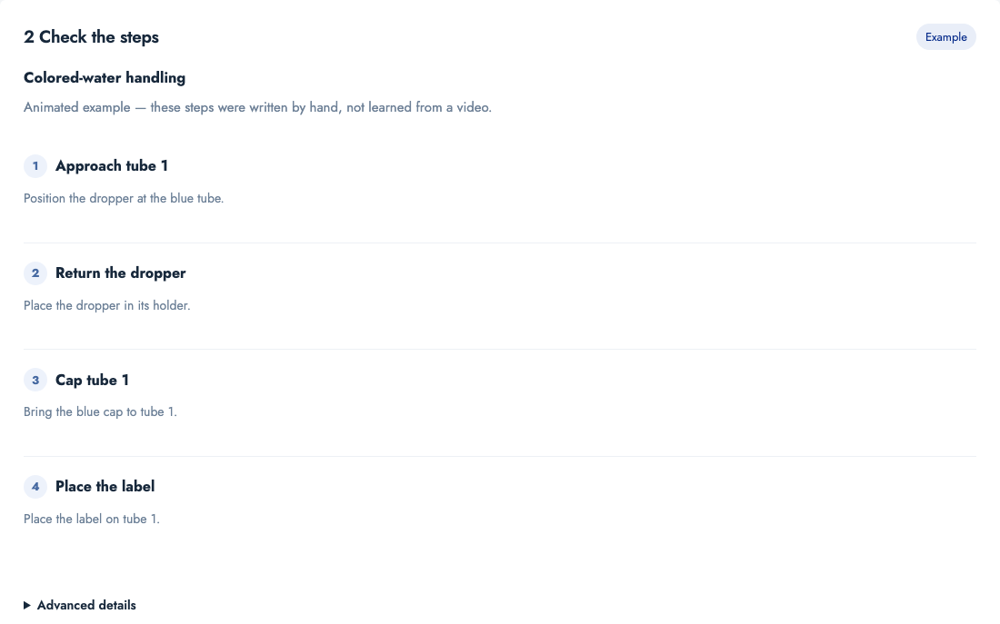
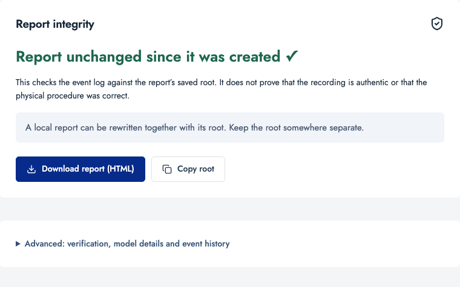
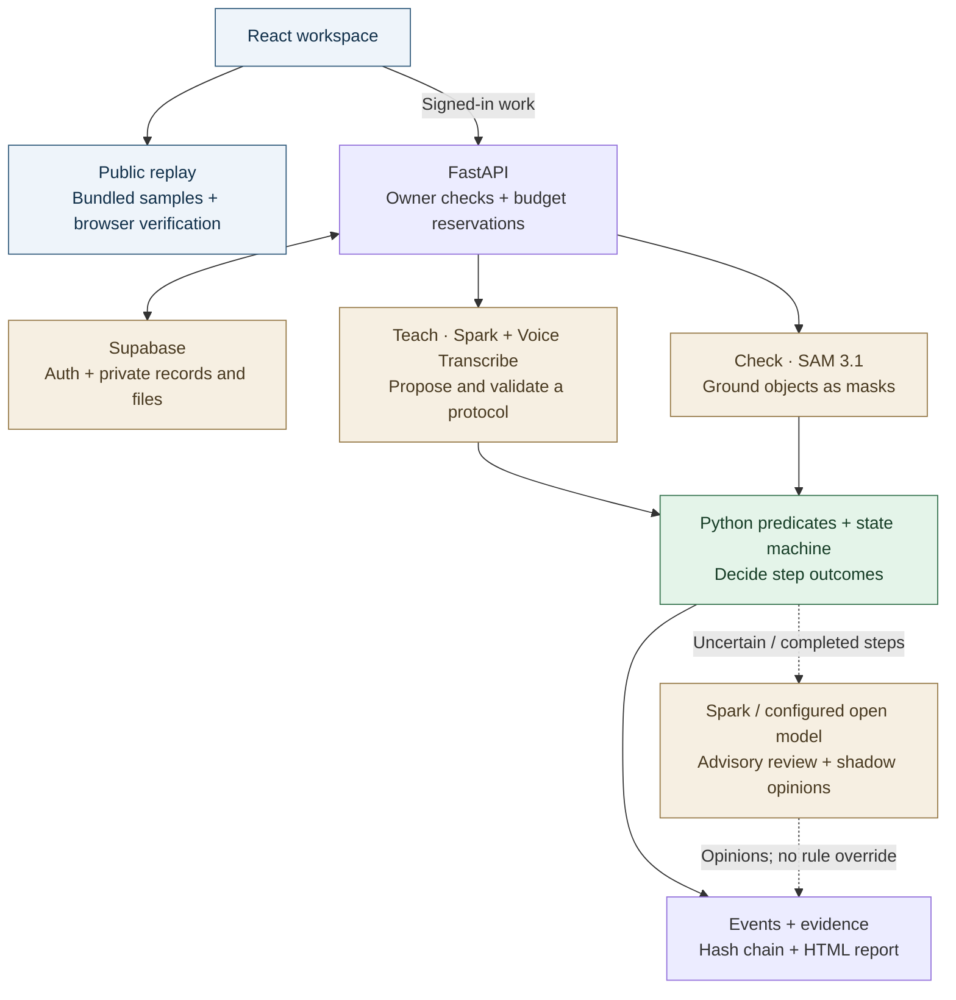

<div align="center">

# Apprentice

### Show it the right way once. Check every later recording.

Turn a procedure video into a checklist, catch missed or out-of-order steps,<br />
and jump straight to the frame that explains each finding.

[](https://github.com/ryanfer123/Meta-Hackathon/actions/workflows/checks.yml)
[](pyproject.toml)
[](LICENSE)

**[Try the demo](https://apprentice-meta.onrender.com/#/workspace?sample=skipped-cap&view=Results&tab=Replay)** · **[Run locally](#quick-start)** · **[Architecture](#architecture)** · **[Recording guide](docs/RECORDING.md)**

</div>

<a href="https://apprentice-meta.onrender.com/#/workspace?sample=skipped-cap&view=Results&tab=Replay">
  
</a>

*Actual application screenshot, displaying synthetic sample data. The public examples are animated; no models ran for them.*

## See the result in 30 seconds

1. **[Open the skipped-cap example](https://apprentice-meta.onrender.com/#/workspace?sample=skipped-cap&view=Results&tab=Replay).** It opens paused on **Step skipped at 00:17**.
2. Read **Why this was flagged**, then inspect the step or seek through the recording. The earlier time warning remains visible in the event history.
3. Switch to **Integrity** to verify the event chain in your browser and download the standalone report.

No account, model key or backend is needed for bundled replay. Try **Clean procedure**, **Wrong tube**, **Swapped order**, **Excessive dwell** and **Partial occlusion** to see other rule outcomes. Sign in to teach a procedure, check your own recordings and save private work.

> **Current evidence:** the public demo contains six synthetic scenarios. Provider connectivity has been probed, but accuracy on real physical procedures has not been measured. A real-footage replay and three-minute submission video are pending. See [evaluation status](eval/results.md).

## From one demonstration to a reviewable report

| Stage | What you do | What Apprentice does |
| --- | --- | --- |
| **Teach** | Upload a teaching video, with narration or a written description. | Proposes a checklist and step timings for you to review. Checks it against the first video, a second take and deliberately removed/reordered segments. |
| **Check** | Upload another recording of the same procedure. | Finds objects, evaluates their geometry over time and flags missed steps, wrong items, ordering problems or timing deviations. Unclear evidence stays uncertain. |
| **Results** | Select a finding or open the integrity tab. | Shows the frame, expected action and reason; exports an HTML report and a verifiable event chain. |

### Inside the app

<table>
  <tr>
    <td width="50%" valign="top">
      
      <br /><strong>Teach</strong><br />Review simple step cards before checking another recording.
    </td>
    <td width="50%" valign="top">
      
      <br /><strong>Integrity</strong><br />Verify the event log and keep its root separately.
    </td>
  </tr>
</table>

*Screenshots are captured from the running web app, not design mockups. These views use the bundled animated example; they do not show a validated real procedure.*

## Architecture

**Models propose. Pixels ground. Deterministic code decides.**



- **Public replay stays separate from private analysis.** Bundled runs and browser verification work with `/api` blocked. Uploads, paid processing, saved work and My runs require a confirmed account; the API checks ownership independently.
- **Model opinions cannot complete a step.** Pydantic validates proposed protocols and replies; windowed predicates and the state machine determine completion. A bounded recovery action can refine one ambiguous SAM query, then replay the rules on the new evidence.
- **Tracking defaults to SAM image mode.** Native-video tracking is experimental. A completed zero-mask video response triggers a logged, separately budgeted image fallback; missing or ambiguous geometry remains unknown.
- **Calls have limits and provenance.** Clients reserve budgets before requests, cache SAM outputs, and record usage and latency. Cloud jobs use durable Supabase reservations; local work uses SQLite. The optional open-model tier uses the configured provider label rather than calling every reply “Glimmer”.
- **Reports expose the evidence.** A hash chain links events and evidence digests. Detecting a rewritten chain requires a root kept somewhere separate; it does not authenticate the camera or prove physical correctness.

Implementation details: [architecture](docs/ARCHITECTURE.md) · [observed API behavior](docs/meta_api_notes.md) · [deployment](docs/DEPLOYMENT.md).

## Quick start

### Public replay: no keys or backend

Requires **Node 22.9+**. From a fresh clone:

```sh
git clone https://github.com/ryanfer123/Meta-Hackathon.git
cd Meta-Hackathon/frontend
npm ci
VITE_STATIC_REPLAY=true npm run dev
```

Open the URL printed by Vite, then choose **See it catch a mistake**. The checked-in samples already include events, display contours, reports and chain roots.

### Python service and full application

Requires **Python 3.11–3.14**, [uv](https://docs.astral.sh/uv/), Node and **FFmpeg** for recording/audio processing. From the repository root:

```sh
uv sync --frozen
uv run python scripts/export_samples.py
npm --prefix frontend ci
VITE_STATIC_REPLAY=true npm --prefix frontend run build
uv run uvicorn app.main:app --app-dir backend --host 127.0.0.1 --port 8000
```

Open `http://127.0.0.1:8000`. This build serves public replay; live analysis needs the configuration below and a frontend rebuild with static replay disabled.

### Enable private analysis

Copy the example configuration files and fill them locally:

```sh
cp .env.example .env
cp frontend/.env.example frontend/.env.local
```

| Configuration | Purpose |
| --- | --- |
| Backend: `REPLAY_MODE=false`, `MODEL_API_KEY` | Enables paid Meta processing. Keep the key server-side. |
| Backend and frontend: Supabase URL + publishable key | Connects confirmed accounts, owner-scoped records and private storage. Names are in the respective example files. |
| Frontend: `VITE_STATIC_REPLAY=false`, optional `VITE_API_BASE_URL` | Connects private actions to the Python service; blank API URL uses the same origin. |
| Optional backend: `GLIMMER_BASE_URL`, `GLIMMER_API_KEY`, `GLIMMER_MODEL`, `OPEN_TIER_LABEL` | Configures the open-model advisory tier. Baseten uses `meta-models/muse-spark-open-1026`; without an open endpoint, Spark handles advisory review. |
| Hosted backend: `CLOUD_JOBS=true`, `SERVER_BUDGET_KEY` | Enables durable cloud jobs and server-authorized global reservations after database setup. |

Follow [database setup](supabase/README.md) and [deployment configuration](docs/DEPLOYMENT.md) before enabling cloud jobs. Never place a model key, backend budget secret or service-role key in a `VITE_` variable or Git.

Default reservations allow **3,000 SAM image calls**, **6,000 native-video billed frames**, **40 Spark calls/job**, **$8/job** and **$10/day** locally and on the hosted cost/frame settings. Open-tier attempts reserve $0.05 each against the same cost caps, including retries. These are configurable refusal limits, not expected prices or provider billing guarantees. Cloud SAM and model requests transmit selected images to their providers; the pipeline is not offline.

## Development and verification

```sh
uv run pytest -q
uv run ruff check backend scripts eval
uv run ruff format --check backend scripts eval
uv run mypy --strict backend/app
npm --prefix frontend run build
cd frontend
npx playwright install chromium
npm run test:e2e
```

At the T6.1 checkpoint, **281 Python tests** and **136 desktop/mobile browser checks** passed, together with lint, formatting, strict typing and the production build. The [Checks workflow](https://github.com/ryanfer123/Meta-Hackathon/actions/workflows/checks.yml) is the source for current CI status. Tests use synthetic masks and mocked transports, not paid provider requests. Diagnostic scripts require an explicit `--allow-paid-calls` opt-in.

| Area | What is checked |
| --- | --- |
| Rules and tracking | Windowed geometry, flicker/occlusion, ordering, compact mask storage and unknown evidence. |
| Access and budgets | Private job ownership, public sample boundaries, reservation refusal and cached responses. |
| Review and integrity | Advisory routing, shadow escalation, bounded recovery and event-chain tampering. |
| Browser flows | Signed-out static replay, intended headline alerts, guided Teach, auth boundaries and integrity verification on desktop/mobile. |

## Scope and limitations

Apprentice currently targets **one procedure per protocol, viewed from a single camera on a tabletop**. The colored-water example checks visible handling. Geometry cannot establish liquid concentration, volume, sterility or cap tightness, and identical or occluded props can remain ambiguous.

Real expert A/B recordings, a labelled dev/test set, frozen-test metrics, a consented public recording and the submission video are still pending. Synthetic test success and short provider probes are not an accuracy or generalization claim. See [evaluation status](eval/results.md) and [limitations](docs/LIMITATIONS.md).

## Project map

```text
backend/app/        API, model clients, predicates, supervision and reports
backend/tests/      Deterministic tests and sanitized provider fixtures
frontend/           React workspace, public replay and browser tests
scripts/            Sample export, opt-in probes and batch processing
eval/               Labelled-run evaluator and results status
supabase/           Database migrations and access policies
docs/               Recording, architecture and deployment guides
```

For recording and evaluation, start with the [recording guide](docs/RECORDING.md); label runs before inspecting predictions and tune only on the dev split. Fixes and contributions should preserve rule authority, account boundaries, budget reservations and honest provenance. Include tests for behavior changes and run the checks above before opening a pull request.

<details>
<summary>Maintainer reference</summary>

[QA notes](docs/QA.md) · [Database migrations](supabase/README.md) · [New work](docs/NEW_WORK.md) · [Submission checklist](docs/SUBMISSION.md)

</details>

## License and acknowledgments

Project source is [MIT licensed](LICENSE). Third-party footage, model weights and dependencies retain their own terms. The Science Buddies tutorial is credited as a reference in [acknowledgments](acknowledgment.md); attribution does not imply permission to redistribute its video.
