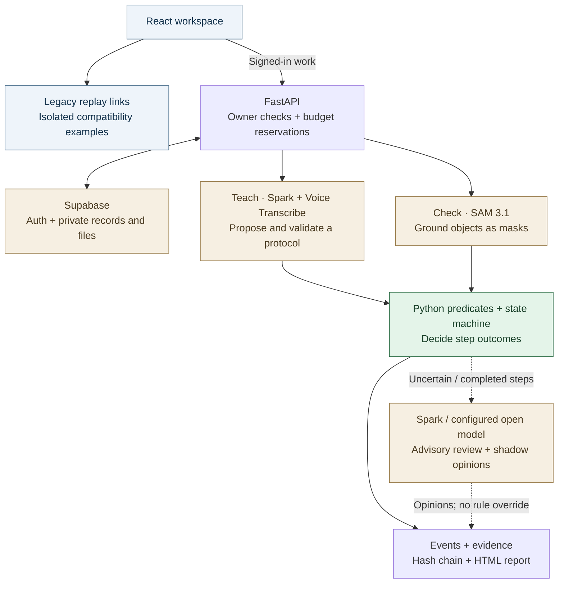

<div align="center">

# Apprentice

### Show it once. Check each step.

Teach a hands-on procedure from video, check the next recording,<br />
and review each finding alongside its visible evidence.

[](https://github.com/ryanfer123/Meta-Hackathon/actions/workflows/checks.yml)
[](pyproject.toml)
[](LICENSE)

**[Open Apprentice](https://apprentice-meta.onrender.com)** · **[Run locally](#quick-start)** · **[Architecture](#architecture)** · **[Recording guide](docs/RECORDING.md)**

</div>

<a href="https://apprentice-meta.onrender.com">
  
</a>

Beige is the default. Use the theme switch to choose a near-black workspace; the preference stays in your browser. Motion respects the device's reduced-motion setting.

<details>
<summary>View dark mode</summary>

</details>

## Version history

The [pre-November-4 snapshot](https://github.com/ryanfer123/Meta-Hackathon/tree/hackathon-pre-nov4) is frozen at `ccbed0f` (November 2). It records the last main-branch commit before November 4 in Eastern Time; it is not proof of the platform submission revision. Post-event maintenance is explicitly dated and new pilot/reliability development lives on `post-hackathon/reliability-and-pilot`.

## Post-event development

The development branch adds explicit stage resume, a three-frame object preview, optional procedure-only trimming, clearer rule-result counts, and injectable geometry/opinion adapters. These changes are implemented on this branch and are not yet promoted to the hosted main-branch app. They do not establish real-world accuracy. The [small pilot guide](docs/PILOT.md) describes blind labelling and a 6–8-recording evaluation; independent recordings and an actual user trial are still needed.

## Start with your procedure

1. **Teach.** Sign in and upload a short video showing the right way. Add narration or a written description, then review the generated steps and timings.
2. **Validate.** Use a genuinely different take to check the protocol. Review which checks passed and which need attention.
3. **Check.** Upload the next recording of the same procedure. Follow stage progress and its estimated time remaining.
4. **Review.** Open the findings at their timestamps, inspect object overlays, and download the report. Unclear actions remain unconfirmed.

Your recordings, checklists and results belong to your account. A new workspace starts empty; the app does not populate it with demonstration results.

## Inside the workspace

<table>
  <tr>
    <td width="50%" valign="top">
      
      <br /><strong>Teach</strong><br />Start with a recording of the right way.
    </td>
    <td width="50%" valign="top">
      
      <br /><strong>Check</strong><br />Compare the next take with the reviewed checklist.
    </td>
  </tr>
</table>

*Fresh captures of the running application. Empty workspace shown; these images do not represent an analysed recording. Reproduce them with `CAPTURE_PRODUCT=1 npm --prefix frontend run test:e2e -- --grep 'capture current product'`.*

## Architecture

**Models propose. Pixels ground. Deterministic code decides.**



- **The product starts with your recordings.** Uploads, paid processing, saved work and My runs require a confirmed account; the API checks ownership independently. Existing example deep links remain isolated for backwards compatibility and test coverage, with their original provenance labels. They are not linked from the normal homepage or workspace.
- **Reviews explain uncertainty.** Unfinished steps name the blocking evidence or earlier step. Model reviews use the target step and timestamped measurements; long opinions are collapsed and explicitly advisory. These changes are tested offline, not a measured accuracy improvement.
- **Model opinions cannot complete a step.** Pydantic validates proposed protocols and replies; windowed predicates and the state machine determine completion. A bounded recovery action can refine one ambiguous SAM query, then replay the rules on the new evidence.
- **Processing shows its work.** Teach and Check display the current stage, completed work and an elapsed-time-based estimate for that stage. Image requests run in bounded batches of three without reducing evidence or bypassing budgets; see [the small measured control](docs/meta_api_notes.md#image-concurrency-and-progress--october-31-2026).
- **Choose faster tracking per analysis.** Enable **Faster video tracking (preview)** in Check or when validating two teaching videos. It requests the video once per object description; image tracking remains the default. Completed zero-mask responses trigger a logged, separately budgeted image fallback and are cached so repeating the same inputs does not pay for that failed video query again. Missing or ambiguous geometry stays unknown. Check accepts one procedure recording up to **five minutes** in native video mode, subject to memory, frame and spending caps checked before paid tracking. Teach accepts up to **five minutes**; validation of either take beyond 90 seconds requires native video tracking. Image tracking stays limited to **90 seconds**. New teaching protocols use evidence frames up to 512 px on the long side, preserving that resolution for later checks. Both validation timelines are checked together against a 192 MiB packed-mask cap before tracking; native input remains at 4 fps/up to 640 px. The full timeline is sampled at 2 fps; recordings are not silently shortened, and repeated procedure cycles need separate runs. A bounded decoded-mask cache also avoids repeating the Python mask codec; see the [tracking-only measurements and limits](docs/meta_api_notes.md#per-job-native-tracking-and-decoded-cache-control--november-1-2026).
- **The free worker processes one analysis at a time.** Overlapping submissions receive a retryable busy response before processing. The Docker build compiles the installed SAM codec with mypyc, retains its original source/license and verifies pixel/error parity. Local generated-mask decoding measured about 3× faster; this is not a hosted end-to-end speed claim. Native tracking also consumes the already-decoded result directly, including concepts too large for the small cache.
- **Uploads are checked before analysis.** Private cloud jobs allow **90 MiB combined** for the teaching and second videos (or one Check recording), within the configured per-file limit. Rejected replacements preserve the previous recording and confirmed timings. Archives are built on disk and uploaded in bounded chunks; the final 110 MiB archive limit still applies.
- **Calls have limits and provenance.** Clients reserve budgets before requests, cache SAM outputs, and record usage and latency. Cloud jobs use durable Supabase reservations; local work uses SQLite. The optional open-model tier uses the configured provider label rather than calling every reply “Glimmer”.
- **Reports expose the evidence.** A hash chain links events and evidence digests. Detecting a rewritten chain requires a root kept somewhere separate; it does not authenticate the camera or prove physical correctness.

Implementation details: [architecture](docs/ARCHITECTURE.md) · [observed API behavior](docs/meta_api_notes.md) · [deployment](docs/DEPLOYMENT.md).

## Quick start

### Frontend development

Requires **Node 22.9+**. From a fresh clone:

```sh
git clone https://github.com/ryanfer123/Meta-Hackathon.git
cd Meta-Hackathon/frontend
npm ci
VITE_STATIC_REPLAY=false npm run dev
```

Open the URL printed by Vite. The homepage renders without model keys; signed-in uploads require the private analysis configuration below. The ordinary workspace starts with your recordings.

### Python service and full application

Requires **Python 3.11–3.14**, [uv](https://docs.astral.sh/uv/), Node and **FFmpeg** for recording/audio processing. From the repository root:

```sh
uv sync --frozen
uv run python scripts/export_samples.py
npm --prefix frontend ci
VITE_STATIC_REPLAY=false npm --prefix frontend run build
uv run uvicorn app.main:app --app-dir backend --host 127.0.0.1 --port 8000
```

Open `http://127.0.0.1:8000`. The service serves the frontend and API together. Live analysis needs the configuration below.

### Enable private analysis

Copy the example configuration files and fill them locally:

```sh
cp .env.example .env
cp frontend/.env.example frontend/.env.local
```

| Configuration | Purpose |
| --- | --- |
| Backend: `REPLAY_MODE=false`, `MODEL_API_KEY`, optional `SPARK_MAX_OUTPUT_TOKENS` | Enables paid Meta processing. The bounded response limit defaults to 12,000 tokens. Keep the key server-side. |
| Backend and frontend: Supabase URL + publishable key | Connects confirmed accounts, owner-scoped records and private storage. Names are in the respective example files. |
| Frontend: `VITE_STATIC_REPLAY=false`, optional `VITE_API_BASE_URL` | Connects private actions to the Python service; blank API URL uses the same origin. |
| Optional backend: `GLIMMER_BASE_URL`, `GLIMMER_API_KEY`, `GLIMMER_MODEL`, `OPEN_TIER_LABEL` | Configures the open-model advisory tier. Baseten uses `meta-models/muse-spark-open-1026`; without an open endpoint, Spark handles advisory review. |
| Hosted backend: `CLOUD_JOBS=true`, `SERVER_BUDGET_KEY` | Enables durable cloud jobs and server-authorized global reservations after database setup. |

Follow [database setup](supabase/README.md) and [deployment configuration](docs/DEPLOYMENT.md) before enabling cloud jobs. Never place a model key, backend budget secret or service-role key in a `VITE_` variable or Git.

Default reservations allow **3,000 SAM image calls**, **18,000 native-video billed frames**, **40 Spark calls/job**, **$8/job** and **$15/day** locally and on the hosted cost/frame settings. Open-tier attempts reserve $0.05 each against the same cost caps, including retries. These are configurable refusal limits, not expected prices or provider billing guarantees. Cloud SAM and model requests transmit selected images to their providers; the pipeline is not offline.

## Development and verification

```sh
uv run pytest -q
uv run ruff check backend scripts eval
uv run ruff format --check backend scripts eval
uv run mypy --strict backend/app
npm --prefix frontend run build
cd frontend
npx playwright install chromium
npm run test:e2e
```

Latest local verification: **379 Python tests** and **169 desktop/mobile browser checks** passed, together with lint, formatting, strict typing and the production build. The two documentation-capture cases run only with the explicit capture flag; pointer tilt is intentionally disabled for touch devices. The [Checks workflow](https://github.com/ryanfer123/Meta-Hackathon/actions/workflows/checks.yml) is the source for current CI status. Tests use synthetic masks and mocked transports, not paid provider requests. Diagnostic scripts require an explicit `--allow-paid-calls` opt-in.

| Area | What is checked |
| --- | --- |
| Rules and tracking | Windowed geometry, flicker/occlusion, ordering, compact mask storage and unknown evidence. |
| Access and budgets | Private job ownership, public sample boundaries, reservation refusal and cached responses. |
| Review and integrity | Advisory routing, shadow escalation, bounded recovery and event-chain tampering. |
| Browser flows | Account-first uploads, empty real-workflow states, guided Teach, auth boundaries and legacy replay/integrity compatibility on desktop/mobile. |

## Scope and limitations

Apprentice currently targets **one procedure per protocol, viewed from a single camera on a tabletop**. Geometry checks visible handling; it cannot establish hidden properties such as transferred volume or fastening tightness. Identical or occluded props can remain ambiguous.

Real expert A/B recordings, a labelled dev/test set, frozen-test metrics, a consented public recording and the submission video are still pending. Synthetic test success and short provider probes are not an accuracy or generalization claim. See [evaluation status](eval/results.md) and [limitations](docs/LIMITATIONS.md).

## Project map

```text
backend/app/        API, model clients, predicates, supervision and reports
backend/tests/      Deterministic tests and sanitized provider fixtures
frontend/           React workspace, public replay and browser tests
scripts/            Sample export, opt-in probes and batch processing
eval/               Labelled-run evaluator and results status
supabase/           Database migrations and access policies
docs/               Recording, architecture and deployment guides
```

For recording and evaluation, start with the [recording guide](docs/RECORDING.md); label runs before inspecting predictions and tune only on the dev split. Fixes and contributions should preserve rule authority, account boundaries, budget reservations and honest provenance. Include tests for behavior changes and run the checks above before opening a pull request.

<details>
<summary>Maintainer reference</summary>

[Pilot guide](docs/PILOT.md) · [Database setup](supabase/README.md) · [Historical event files](archive/hackathon/README.md)

</details>

## License and acknowledgments

Project source is [MIT licensed](LICENSE). Third-party footage, model weights and dependencies retain their own terms. The Science Buddies tutorial is credited as a reference in [acknowledgments](acknowledgment.md); attribution does not imply permission to redistribute its video.
