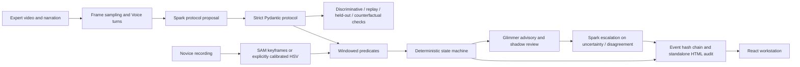

# Architecture

Apprentice is a web workstation backed by a deterministic Python observer. Public replay is static and needs no model keys. Optional accounts use Supabase for persistence. Live work uses the same predicates and state machine after Meta-derived masks replace synthetic masks.

`meta_client.py` owns all hosted Meta transport, request reservations, SAM cache and call logs. `glimmer_client.py` owns the OpenAI-compatible Glimmer endpoint. Both reject malformed model output; at most two retries follow the first attempt. Rules alone emit completion. Model confidence is advisory and not a calibrated probability.

`FrameState` includes masks, model scores, timestamps and explicit coverage. Missing detections are unknown. The current keyframe adapter refuses ambiguous multiple candidates for an object prompt; choose distinctly colored/labeled props. It does not claim stable identities for indistinguishable tubes. There is no silent HSV fallback; colors must be explicitly calibrated in the protocol.

The state machine requires a confidently false postcondition before a later stably true one, and action history. Groups permit alternate ordering within contiguous groups. Skips are inferred when a later critical action is observed; an unfinished final step remains uncertain. Each rule event includes a timestamp and evidence reference. Model disagreement queues human review without rewriting rule outcomes.

SQLite reservations use `BEGIN IMMEDIATE`, so call limits survive concurrent workers and restarts. Failed requests still consume reservations. Actual bills and provider credit notifications are separate. File storage is local and scoped to random IDs. Live inference is intended for a trusted local/private instance; the public site serves replay only.

Hash-chain scope: canonical event JSON, evidence-image digest, previous digest. Independent verification needs a separately trusted root. The chain does not authenticate the camera, operator, protocol, or physical truth.

Real output has a source-video SHA-256 for frozen evaluation provenance. Static samples export the engine's results, never fictitious Meta answers. Uploaded videos and account configuration remain outside version control.

## Supabase persistence

The React client uses a publishable key and the signed-in user JWT. Owner-scoped RLS protects `protocol_records`, `run_records`, and `recordings`; private Storage paths begin with the owner UUID. `save_run_snapshot` and `delete_run_snapshot` are SECURITY INVOKER RPCs with an empty search path, so transactional operations preserve RLS. Browser sessions are not an authorization boundary; Postgres policies are.

A run library holds complete review snapshots. Uploads are limited to non-empty MP4/MOV files up to 50 MB, with 60-second signed preview links. Storage and row inserts use compensating cleanup on failure; unlike the snapshot RPC, file plus metadata operations are not one distributed transaction. Interrupted uploads may require orphan cleanup. Cloud storage does not schedule Python inference. The inference service remains separately configured and private.

## Mandatory identity and API-only processing

The public homepage opens a mandatory account screen for every workspace route. Persisted sessions are checked with Supabase Auth before rendering the workspace. The API separately calls Auth's user endpoint, requires a confirmed non-anonymous user, and checks job ownership for status, reports, source media and validation. Browser media/report requests carry the access token in a header; no JWT query parameters or model keys are used.

The default advisory path uses hosted Spark for uncertain windows and every completed-step shadow opinion. Glimmer is optional and unused in API-only mode. Rules still make all pass/fail decisions.

`analysis_jobs` and a private artifact bucket store durable results/archives. Restoring an archive only accepts an exact file allowlist with an expanded-size cap; path traversal is rejected. One processing job per account is enforced by a unique partial index. A worker restart makes abandoned work explicitly fail; no automatic paid retries.

The server-only budget key is hashed in the private database configuration and held as a runtime secret by the API. The reservation RPC serializes the global budget before any Meta request. Authenticated browser clients cannot reserve without that key or read the ledger. Its SECURITY DEFINER scope is limited and deliberately documented; ordinary job/storage operations use the user's JWT and RLS.
