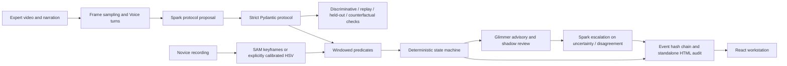

# Architecture

Apprentice is a web workstation backed by a deterministic Python observer. Public replay is static and key-free. Live work uses the same predicates and state machine after Meta-derived masks replace synthetic masks.

`meta_client.py` owns all hosted Meta transport, request reservations, SAM cache and call logs. `glimmer_client.py` owns the OpenAI-compatible Glimmer endpoint. Both reject malformed model output; at most two retries follow the first attempt. Rules alone emit completion. Model confidence is advisory and not a calibrated probability.

`FrameState` includes masks, model scores, timestamps and explicit coverage. Missing detections are unknown. The current keyframe adapter refuses ambiguous multiple candidates for an object prompt; choose distinctly colored/labeled props. It does not claim stable identities for indistinguishable tubes. There is no silent HSV fallback; colors must be explicitly calibrated in the protocol.

The state machine requires a confidently false postcondition before a later stably true one, and action history. Groups permit alternate ordering within contiguous groups. Skips are inferred when a later critical action is observed; an unfinished final step remains uncertain. Each rule event includes a timestamp and evidence reference. Model disagreement queues human review without rewriting rule outcomes.

SQLite reservations use `BEGIN IMMEDIATE`, so call limits survive concurrent workers and restarts. Failed requests still consume reservations. Actual bills and provider credit notifications are separate. File storage is local and scoped to random IDs. Live inference is intended for a trusted local/private instance; the public site serves replay only.

Hash-chain scope: canonical event JSON, evidence-image digest, previous digest. Independent verification needs a separately trusted root. The chain does not authenticate the camera, operator, protocol, or physical truth.

Real output has a source-video SHA-256 for frozen evaluation provenance. Static samples export the engine's results, never fictitious Meta answers. Uploaded videos and account configuration remain outside version control.
