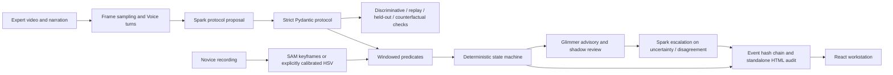

# Architecture

Apprentice is a web workstation backed by a deterministic Python observer. Public replay is static and needs no model keys. Optional accounts use Supabase for persistence. Live work uses the same predicates and state machine after Meta-derived masks replace synthetic masks.

`meta_client.py` owns all hosted Meta transport, request reservations, SAM cache and call logs. `glimmer_client.py` owns the OpenAI-compatible Glimmer endpoint. Both reject malformed model output; at most two retries follow the first attempt. Rules alone emit completion. Model confidence is advisory and not a calibrated probability.

`FrameState` includes masks, model scores, timestamps and explicit coverage. Missing detections are unknown. The current keyframe adapter refuses ambiguous multiple candidates for an object prompt; choose distinctly colored/labeled props. It does not claim stable identities for indistinguishable tubes. There is no silent HSV fallback; colors must be explicitly calibrated in the protocol.

The state machine requires a confidently false postcondition before a later stably true one, and action history. Groups permit alternate ordering within contiguous groups. Skips are inferred when a later critical action is observed; an unfinished final step remains uncertain. Each rule event includes a timestamp and evidence reference. Model disagreement queues human review without rewriting rule outcomes.

SQLite reservations use `BEGIN IMMEDIATE`, so call limits survive concurrent workers and restarts. Failed requests still consume reservations. Actual bills and provider credit notifications are separate. File storage is local and scoped to random IDs. Live inference is intended for a trusted local/private instance; the public site serves replay only.

Hash-chain scope: canonical event JSON, evidence-image digest, previous digest. Independent verification needs a separately trusted root. The chain does not authenticate the camera, operator, protocol, or physical truth.

Real output has a source-video SHA-256 for frozen evaluation provenance. Static samples export the engine's results, never fictitious Meta answers. Uploaded videos and account configuration remain outside version control.

## Supabase persistence

The React client uses a publishable key and the signed-in user JWT. Owner-scoped RLS protects `protocol_records`, `run_records`, and `recordings`; private Storage paths begin with the owner UUID. `save_run_snapshot` and `delete_run_snapshot` are SECURITY INVOKER RPCs with an empty search path, so transactional operations preserve RLS. Browser sessions are not an authorization boundary; Postgres policies are.

A run library holds complete review snapshots. Uploads are limited to non-empty MP4/MOV files up to 50 MB, with 60-second signed preview links. Storage and row inserts use compensating cleanup on failure; unlike the snapshot RPC, file plus metadata operations are not one distributed transaction. Interrupted uploads may require orphan cleanup. Cloud storage does not schedule Python inference. The inference service remains separately configured and private.

## Mandatory identity and API-only processing

The public homepage links directly to read-only synthetic samples in Supervise, Audit and Learn. These render from bundled assets without an account or backend, and browser chain verification is local. Private routes and actions require confirmed accounts. Persisted sessions are checked with Supabase Auth before rendering private state; workspace trees are remounted when the account changes so sign-out cannot retain private runs or form values. The API separately calls Auth's user endpoint, requires a confirmed non-anonymous user, and checks job ownership for status, reports, source media and validation. Browser media/report requests carry the access token in a header; no JWT query parameters or model keys are used.

The default advisory path uses hosted Spark for uncertain windows and every completed-step shadow opinion. Glimmer is optional and unused in API-only mode. Rules still make all pass/fail decisions.

`analysis_jobs` and a private artifact bucket store durable results/archives. Restoring an archive only accepts an exact file allowlist with an expanded-size cap; path traversal is rejected. One processing job per account is enforced by a unique partial index. A worker restart makes abandoned work explicitly fail; no automatic paid retries.

The server-only budget key is hashed in the private database configuration and held as a runtime secret by the API. The reservation RPC serializes the global budget before any Meta request. Authenticated browser clients cannot reserve without that key or read the ledger. Its SECURITY DEFINER scope is limited and deliberately documented; ordinary job/storage operations use the user's JWT and RLS.

Public sample API access uses a method/path allowlist for six known sample IDs. Reads materialize deterministic local fixtures even with cloud jobs enabled, never invoking Auth, Meta, Supabase writes or the budget ledger. Private job folder regex/owner checks remain. A bounded per-process limiter retains up to 4096 socket IPs and permits 30 public sample requests per rolling minute per IP; it does not trust forwarded headers or coordinate multiple workers.

## Compact masks and bounded display payloads (T2)

`Detection(mask, score, obj_class, known_absent)` keeps its existing constructor and `mask` property. Construction snapshots each two-dimensional mask into immutable `np.packbits` bytes with its original shape; lazy unpacking restores every original boolean pixel, including non-byte-aligned shapes. `None`, empty masks, confidence and explicit absence remain distinct. Decoded rasters are read-only. Each instance has a weak cache reference, backed by an 8 MiB process-wide LRU rather than an unbounded full-raster cache on every history object. Caller-held temporary arrays are outside that internal cache budget.

The synthetic memory regression builds 180 frames × 8 independent detections at 1024×768, reads every mask, and counts actual packed `bytes` headers, detection/shape/weak-reference metadata and cached ndarray `nbytes`. Packed payload plus byte headers measured 141,605,280 bytes; cached raster payload/headers measured 7,865,600 bytes in the standalone check. The regression requires stored mask memory below 200,000,000 bytes. This is not peak process RSS: OpenCV scratch space, decoded source frames, JSON and caller-owned arrays also use memory. Two concurrently retained videos roughly double packed history storage.

`wire_frame` preserves simple outlines exactly. When an object's contours exceed 256 points, display-only `cv2.approxPolyDP` begins at 1.5 px tolerance, doubling only if an individual contour still cannot fit. It then keeps the largest-area components within a 256-point total budget. `contour_tolerance_px` records the tolerance and `contours_truncated` reports omitted components. Bounding boxes still come from the full mask. Predicates and evidence overlays never consume these display approximations.

For a seeded noisy-mask stress case representing 90 seconds at 2 fps (180 observations, 8 objects, 1024×768), final canonical `run.json` measured 24,361,428 bytes with the previous full contours and 4,613,268 bytes with the display cap. All six existing bundled sample JSON payloads remain identical. This bounds contour data per object; arbitrary event logs or larger protocols can still increase total output size.

## Native-video SAM and billed-frame reservations (T3)

The production tracker can submit a CFR 4 fps H.264 MP4 (long side <=640, no audio) once per distinct prompt. Original 2 fps JPEGs remain the evidence source. Prepared clips and raw completed model text have hash/transcode-keyed caches. Official video parsing supplies source indices and mask identities; diagnostic/empty/ambiguous output remains unknown, confidence stays 0.5 when absent, and scene completeness stays false. Left-to-right name bindings never follow a new ID by centroid guess after ambiguity.

SAM usage reports billed frames, with a minimum 50/request, not an actual output sampling rate. Frame reservations replace image-call counting for video requests and share one job budget across both expert takes. The approved local cap is 6,000 frames; hosted limits remain independently configurable. The private SQL ledger serializes reservations and unexpected-billing reconciliations using its existing backend-secret gate.

## Open-model reservation guard

Every configured open-tier request reserves $0.05 before network I/O, including schema retries, through the same `Budget` ledger as Meta calls. Hosted reservations use routing kind `glimmer`, independent of the displayed provider label; they share the job/day cost caps and retain failed-attempt reservations. The reservation is a refusal threshold, not a provider pricing claim.
